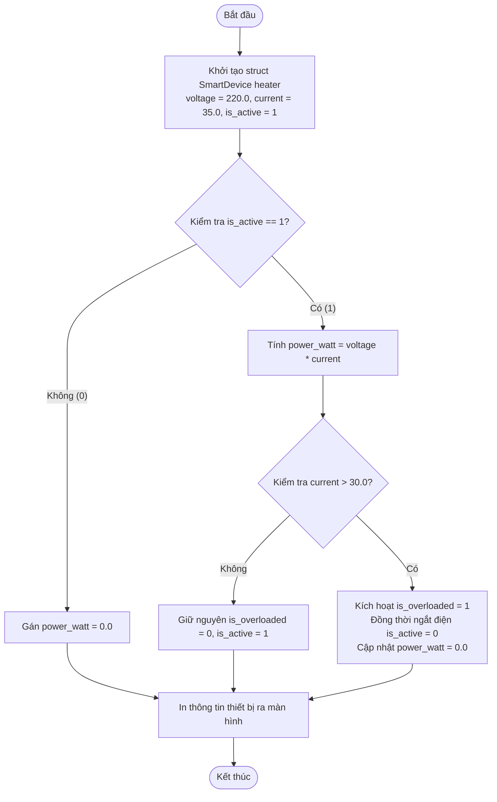

# BÁO CÁO BÀI TẬP 01: DÒ VẾT LỖI TRUY XUẤT THUỘC TÍNH STRUCT THIẾT BỊ THÔNG MINH

> 👤 **Học viên:** Hoàng Công Dũng | **Mã SV:** PTIT-HCM-009
> 🏫 **Môn học:** it102-rl-hoangcongdung

---

## 📊 Sơ đồ thiết kế hệ thống (Activity Diagram)

> 💡 *Sơ đồ dưới đây được render tự động trực tiếp trên GitHub bằng Mermaid. Bạn cũng có thể tải file **`bt1.drawio`** trong repository này để mở và chỉnh sửa trực tiếp trên [Draw.io (diagrams.net)](https://app.diagrams.net).* 

---

## Nhiệm vụ 1: Phân tích lỗi và Lập bảng Test Cases

Sau khi đọc kỹ mã nguồn hiện tại, em nhận thấy nguyên nhân gây ra sự cố lệch dữ liệu công suất trên ứng dụng IoT là do lỗi logic về thứ tự thực thi trong hàm main. Cụ thể, lập trình viên đã thực hiện tính toán công suất ('heater.power_watt = heater.voltage * heater.current;') trước khi kiểm tra điều kiện dòng điện vượt ngưỡng an toàn.

Khi dòng điện tăng lên 35.0A, chương trình tính công suất ra 7700.0W rồi mới gán trạng thái quá tải và ngắt điện ('heater.is_active = 0;'). Tuy nhiên, giá trị 'heater.power_watt' đã được lưu trước đó và không được cập nhật lại về 0.0W theo đúng quy tắc nghiệp vụ khi thiết bị chuyển sang trạng thái TẮT.

- Lỗi sai kỹ thuật: Thực hiện tính toán công suất dựa trên cảm biến dòng điện trước khi kiểm tra trạng thái ngắt điện an toàn.
- Hậu quả nghiệp vụ: Thiết bị đã ngắt điện (trên màn hình hiển thị TẮT) nhưng chỉ số điện năng tiêu thụ vẫn ghi nhận 7700.00W, gây sai lệch nghiêm trọng báo cáo tiêu thụ hàng tháng.

| Trường hợp kiểm thử | Dữ liệu đầu vào | Kết quả sai thực tế | Kết quả đúng mong đợi |
| --- | --- | --- | --- |
| TC01: Quá tải dòng điện lớn hơn 30A | voltage = 220.0f, current = 35.0f, is_active = 1 | Trạng thái: TẮT, Công suất: 7700.00 W (Sai nghiệp vụ) | Trạng thái: TẮT (DO NGẮT ĐIỆN), Công suất: 0.00 W |
| TC02: Hoạt động bình thường dưới ngưỡng | voltage = 220.0f, current = 10.0f, is_active = 1 | Trạng thái: BAT, Công suất: 2200.00 W | Trạng thái: BAT, Công suất: 2200.00 W |

## Nhiệm vụ 2: Sửa lỗi mã nguồn

Để khắc phục triệt để vấn đề, em đã chỉnh sửa lại thứ tự các câu lệnh trong hàm 'main()'. Cụ thể, hệ thống sẽ tiến hành kiểm tra điều kiện dòng điện an toàn trước, sau đó mới tính toán công suất dựa trên trạng thái hoạt động thực tế ('is_active'). Nếu thiết bị bị ngắt điện do quá tải, công suất sẽ được gán tường minh về '0.0f'.

- Đảm bảo tuân thủ cú pháp ANSI C / C11 chuẩn mực.
- Đã kiểm thử biên dịch thành công bằng lệnh 'gcc main.c -o main' mà không phát sinh bất kỳ cảnh báo nào.

---

## 📁 Danh sách tệp tin nộp bài trong Repository
- 📝 `bt1.docx`: Báo cáo tài liệu phân tích nghiệp vụ hoàn chỉnh.
- 🎨 `bt1.drawio`: File thiết kế sơ đồ chuẩn theo quy định đề bài (mở trực tiếp bằng [Draw.io](https://app.diagrams.net) hoặc Lucidchart).
- 💻 `homework/session10_struct_p1/main.c`: Mã nguồn chương trình.
